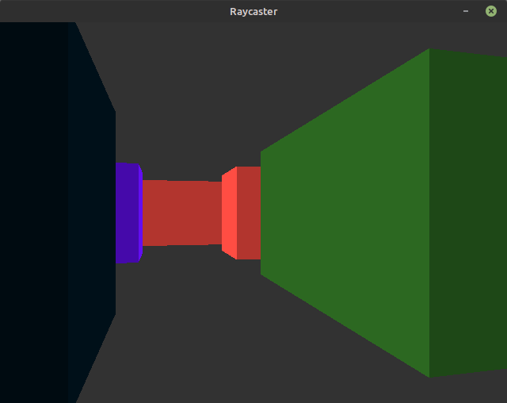

# C-Raycaster
A simple raycaster written in C.

# Features
- WASD / Arrow Key Controls
- Integrated SDL2
- A "random" number generator

# Screenshots

# License
This code is licensed under the GNU GPL v3.0. See COPYING for more information.
